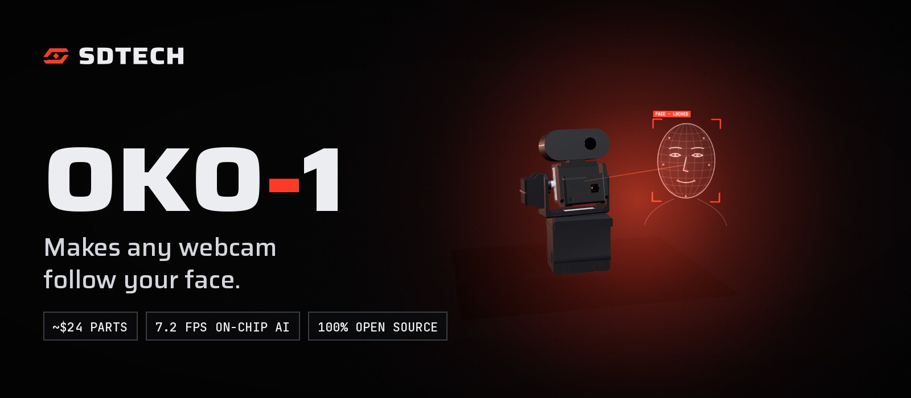
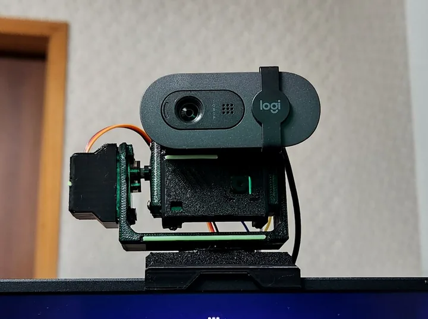
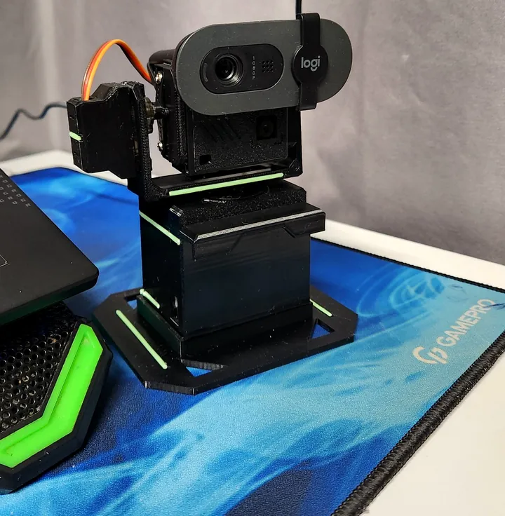

<p align="center">
  
</p>

# OKO-1 — open-source face-tracking robot for any webcam

**OKO-1** is a 3D-printable pan/tilt turret that keeps **any webcam** locked on your face. A $6 ESP32-CAM finds your face on-chip, a second ESP32 drives two MG90S servos, and your own webcam just rides on top. No Wi-Fi, no cloud, no app. About **$22 in parts** (before shipping).

*“Oko” means “eye” in Ukrainian.* First device by **[SDTech](https://sdtech.page)**, designed by [Serhii Dovhyi](https://sdtech.page/about/) with AI as a co-engineer.

**Website, 3D tour and downloads → [sdtech.page](https://sdtech.page)** · **Build guide → [docs/BUILD.md](docs/BUILD.md)** · **Build it with Claude → [docs/CLAUDE_PROMPT.md](docs/CLAUDE_PROMPT.md)**

| | |
|---|---|
| Face detection | 7.2 fps on the ESP32-CAM (Espressif esp-dl), no PC needed |
| Motion | Pan ±80°, tilt −65° / +40°, critically damped easing (no overshoot) |
| Print | PETG, one plate, 134 g, 5 h 16 min, no supports |
| Mount | Laptop lid clip or desk stand |
| Power | USB 5 V from the main board |
| Radio | Off. Wi-Fi and Bluetooth are never started |
| Licence | Code MIT · hardware and docs CC BY 4.0 |

<p>
  
  
</p>

## How it works

```
OV2640 ──► ESP32-CAM ──UART 921600──► ESP32 main ──PWM──► MG90S pan (IO18) + MG90S tilt (IO19)
            face detection on-chip     lag compensation,
            (window around the face    eased motion, aim offset
             after the first lock)
Your webcam ──USB──► laptop   (untouched, works in Zoom / Meet / OBS / Teams)
```

## Read more

- [How to make any webcam follow your face](https://sdtech.page/oko/how-it-works/): gimbal webcams vs software auto-framing vs a motorized mount
- [ESP32-CAM face tracking with servos, explained](https://sdtech.page/oko/esp32-cam-face-tracking/): camera fast path, UART protocol, latency-compensated control law, smoothing, power gotchas
- [Full build guide with pictures](https://sdtech.page/oko/build/)

## Parts

| Part | Qty | ≈ $ | Listing |
|---|---:|---:|---|
| ESP32 DevKit (ESP32-WROOM-32, CP2102) | 1 | 4.40 | [AliExpress](https://www.aliexpress.com/item/32800930387.html) |
| ESP32-CAM AI-Thinker + OV2640 | 1 | 6.40 | [AliExpress](https://www.aliexpress.com/item/4000844206042.html) |
| MG90S metal-gear micro servo (pack of 2) | 2 | 6.15 | [AliExpress](https://www.aliexpress.com/item/1005008626768357.html) |
| Dupont jumpers 20 cm (F-F + M-F, 40 each) | 1 set | 3.20 | [AliExpress](https://www.aliexpress.com/item/1005009071621102.html) |
| WAGO-type 3-way lever connector (pack of 10, one used) | 1 | 0.20 | [AliExpress](https://www.aliexpress.com/item/1005006963063019.html) |
| PETG filament | 134 g | 2.00 | any 1 kg spool |
| Screws M2.5-M3 x 8-10 mm | 4 | | parts box |

Real AliExpress listings checked 18 Nov 2026, item prices before shipping (shipping depends on your country). Total ≈ $22. Any seller works.

## Repository

```
hardware/print/   Bambu Studio projects (sliced for P1S / X1C, PETG): full kit + fit test
hardware/stl/     every part in print orientation
hardware/step/    parts + full assembly (OKO-1_assembly.step)
hardware/cad/     parametric source in Python (build123d): ft_params.py, ft_parts.py, export.py, check.py
firmware/FT_main/ main ESP32: control loop, servos, serial commands, bridge mode for flashing the camera
firmware/FT_cam/  ESP32-CAM: face detection, reports face position over UART
tools/            flash.ps1, flash_cam_bridge.ps1 (no programmer needed), ft_monitor.py (live picture + tuning)
docs/             BUILD.md, CLAUDE_PROMPT.md, photos
```

## Quick start

1. Print `hardware/print/OKO-1_fit_test_PETG_P1S.gcode.3mf`, check the fits, then the full kit.
2. Install the Arduino ESP32 core **2.0.17** and flash the main board: `tools\flash.ps1 main`.
3. Wire the camera (3V3-3V3, GND-GND, U0T-IO16, U0R-IO17) and flash it through the main board: `tools\flash_cam_bridge.ps1`.
4. Assemble ([docs/BUILD.md](docs/BUILD.md)), hang it on your laptop, plug in both USB cables.

Rebuild the parts after changing parameters: `pip install build123d trimesh` then `python hardware/cad/export.py` (writes `hardware/out/`).

## Credits and licence

Firmware, tools and code: [MIT](LICENSE). 3D models, print files, photos and documentation: [CC BY 4.0](LICENSE-HARDWARE.md). You may build, sell and remix OKO-1; credit **“OKO-1 by SDTech / Serhii Dovhyi”** with a link to https://sdtech.page.

Face detection uses Espressif's esp-dl models shipped with the Arduino-ESP32 core.

## Contact

Want a device like this designed for you, or want to hire the person who made it? **sergey@sdtech.page** · [sdtech.page](https://sdtech.page) · [sergeydesigner.pro](https://sergeydesigner.pro)
